# Manual de Usuario — Mini ERP

Guía de las pantallas del sistema, organizada por rol.

---

## Antes de empezar

Abre `http://localhost:4200` en el navegador. Verás la pantalla de inicio de
sesión.

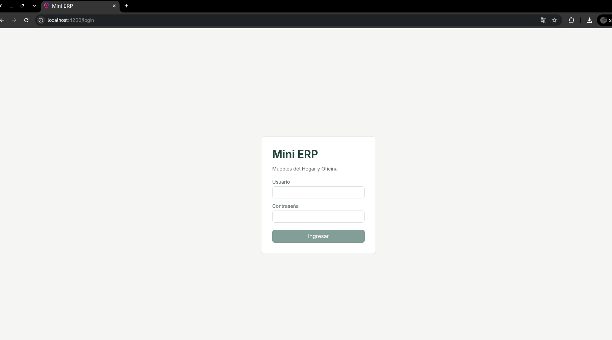

Ingresa tu usuario y contraseña, y presiona **Ingresar**. Si los datos son
incorrectos, aparece un mensaje de error en rojo sobre el formulario.

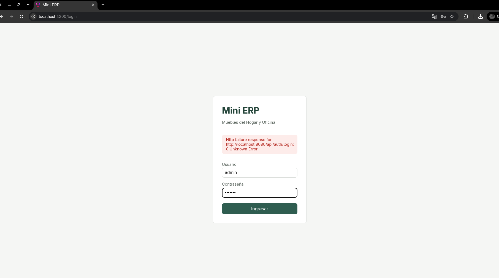

Al entrar correctamente, verás el **menú lateral**, distinto según tu rol —
solo aparecen las opciones que tu rol tiene permitidas. Tu nombre y tu rol se
muestran al pie del menú, junto con el botón **Cerrar sesión**.

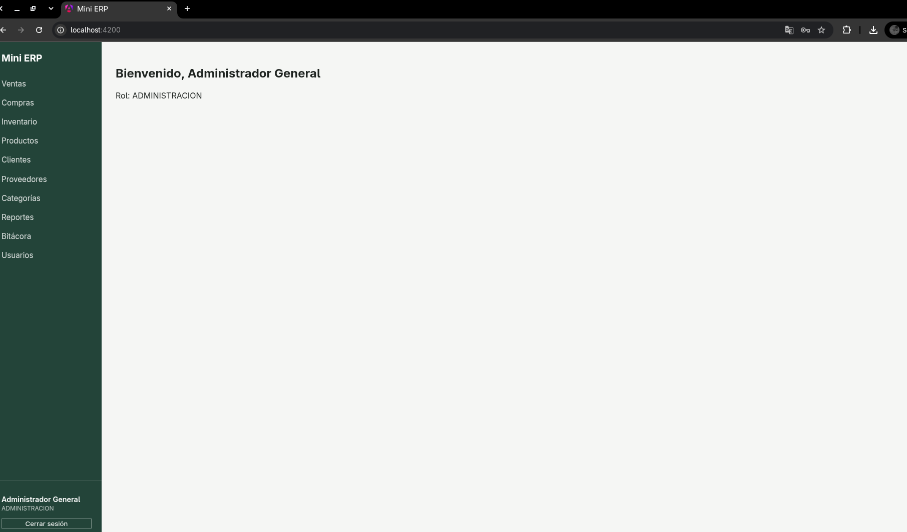

Usuarios de prueba (contraseña de todos: `Erp2026!`):

| Usuario | Rol |
|---|---|
| `admin` | ADMINISTRACION |
| `compras` | COMPRAS |
| `inventario` | INVENTARIO |
| `ventas` | VENTAS |

---

## Rol VENTAS

Menú disponible: **Ventas, Inventario (solo lectura), Clientes, Reportes**.

### Ventas

Pantalla principal del rol. Muestra el historial de ventas (número de
factura, fecha, cliente, total) y el botón **Factura PDF** para descargar la
factura de cualquier venta ya registrada.

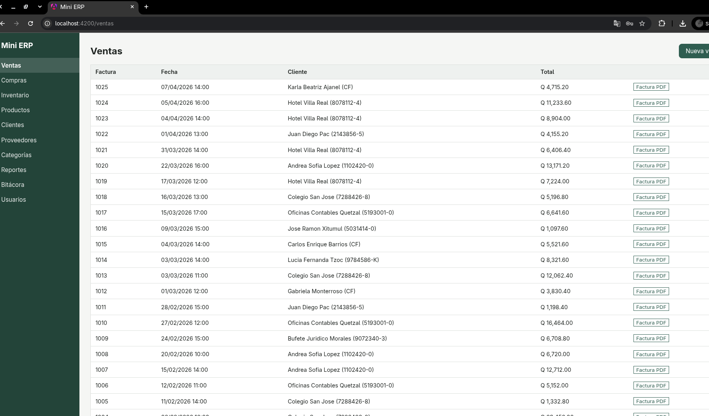

Con **Nueva venta**:

1. Selecciona un cliente.
2. Agrega una o varias líneas: producto y cantidad. El precio y el subtotal de
   cada línea se calculan solos según el producto elegido.
3. El **Subtotal**, el **IVA (12%)** y el **Total** se recalculan en vivo con
   cada cambio.
4. **Registrar venta**. Si la existencia no alcanza, o el producto o el
   cliente están inactivos, el sistema lo rechaza y explica por qué —
   ninguna línea queda registrada a medias.

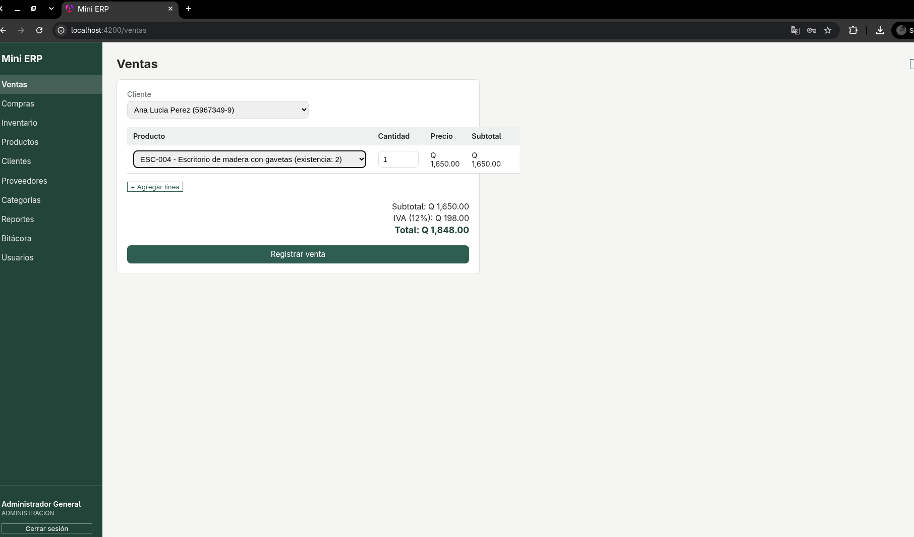

Tras registrar la venta, vuelve al listado; desde ahí se descarga la factura
en PDF.

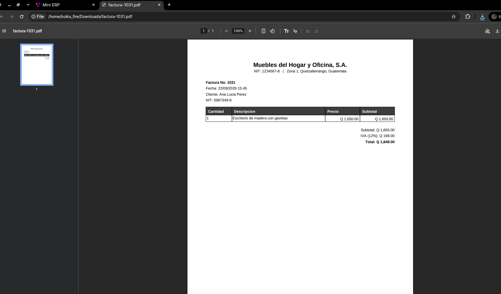

### Inventario

Ver más abajo (sección común a varios roles) — VENTAS solo puede **consultar**
existencias y kardex, no ve la pestaña de alertas de stock.

### Clientes

Listado con búsqueda y filtro de inactivos. **Nuevo cliente** o **Editar**
abren el mismo formulario (NIT, nombre, teléfono, correo, dirección). Varios
clientes pueden compartir el NIT `CF` (consumidor final); cualquier otro NIT
repetido se rechaza. **Desactivar** pide confirmación antes de aplicarse.

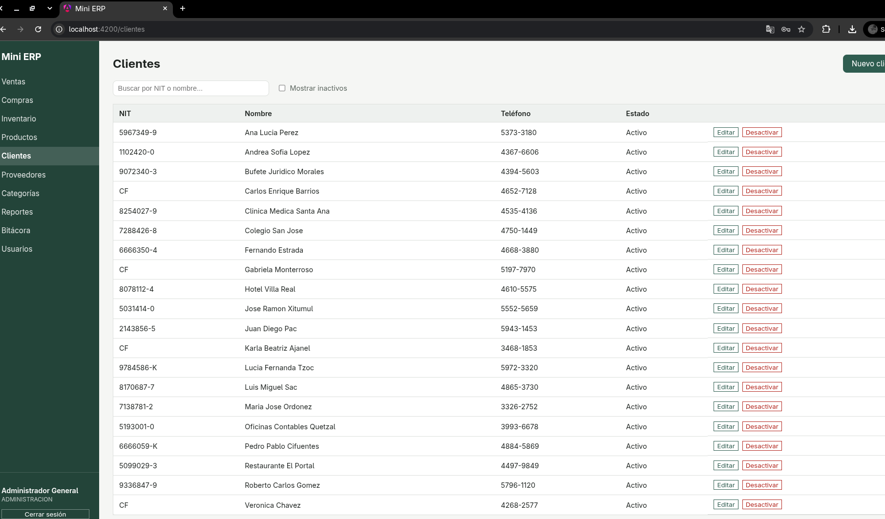

### Reportes

Ver la sección común "Reportes" más abajo — VENTAS ve los reportes de ventas y
clientes.

---

## Rol COMPRAS

Menú disponible: **Compras, Inventario (solo lectura, con alertas), Proveedores, Reportes**.

### Compras

Listado de compras (proveedor, fecha, documento, total).

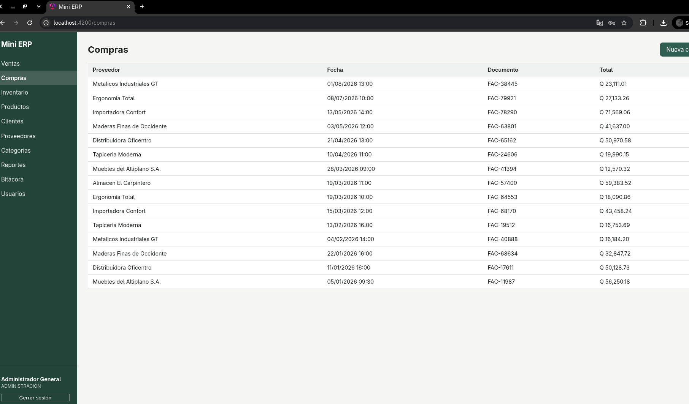

Con **Nueva compra**: proveedor, fecha, número de documento del proveedor, y
una o varias líneas (producto, cantidad, costo unitario). El total se
recalcula en vivo. Si una línea incluye un producto que ese proveedor no
surte, o una cantidad/costo inválido, el sistema la rechaza con un mensaje
claro.

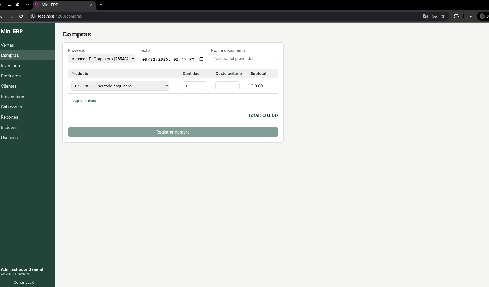

### Proveedores

Listado con búsqueda y filtro de inactivos, crear/editar/desactivar igual que
los demás catálogos. El botón **Productos** despliega un panel para ver,
asociar y desasociar los productos que ese proveedor surte, junto con su costo
de referencia.

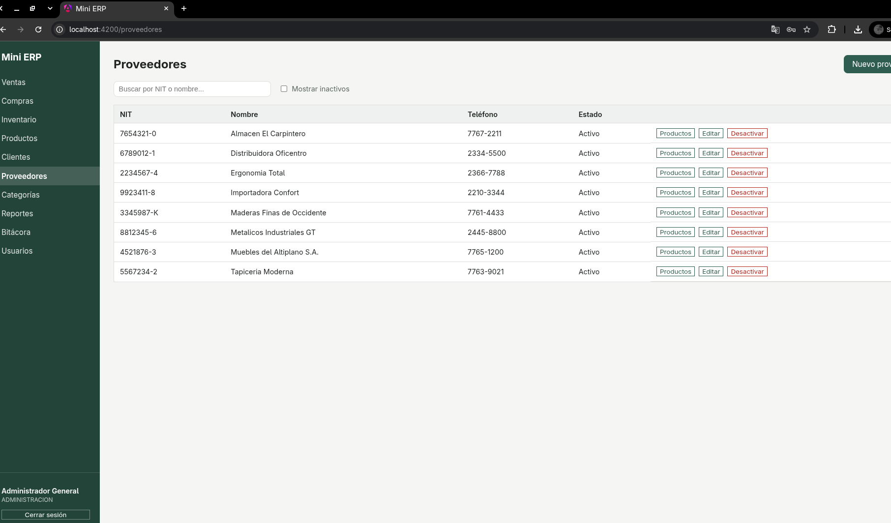

### Inventario

Ver la sección común más abajo — COMPRAS sí ve la pestaña de alertas de stock.

### Reportes

Ver la sección común — COMPRAS ve los reportes de compras y proveedores.

---

## Rol INVENTARIO

Menú disponible: **Inventario, Productos, Categorías, Reportes**.

### Inventario

Tres pestañas:

- **Existencias**: todos los productos con su existencia actual; las filas en
  o bajo el stock mínimo aparecen resaltadas. El botón **Kardex** de cada fila
  lleva directo al historial de movimientos de ese producto.
- **Alertas de stock**: solo los productos que necesitan atención (agotados o
  bajo su mínimo), con la cantidad que falta.
- **Kardex**: movimientos (entradas y salidas) de un producto seleccionado,
  en orden cronológico, con el origen de cada uno (compra, venta) y la
  existencia resultante.

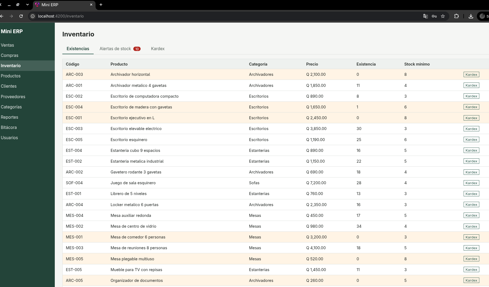

### Productos

Listado con búsqueda y filtro de inactivos. **Nuevo producto** o **Editar**:
código, nombre, descripción, categoría, precio de venta, stock mínimo.
**Desactivar** pide confirmación; el producto conserva todo su historial de
compras y ventas.

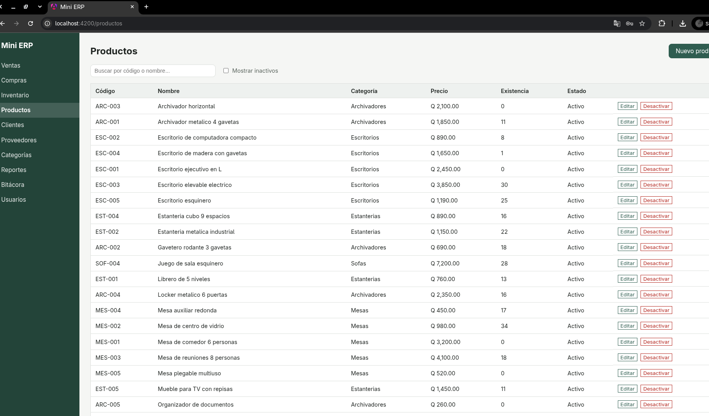

### Categorías

CRUD simple: nombre, descripción, activar/desactivar.

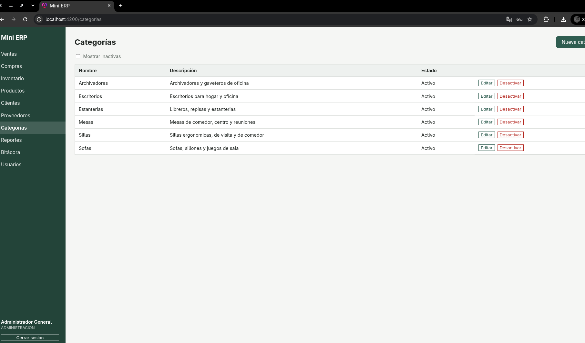

### Reportes

Ver la sección común — INVENTARIO ve los reportes de productos e inventario.

---

## Rol ADMINISTRACION

Ve **todo** lo anterior, más:

### Bitácora

Consulta de todas las acciones registradas por los usuarios, con filtros de
usuario, módulo y rango de fechas.

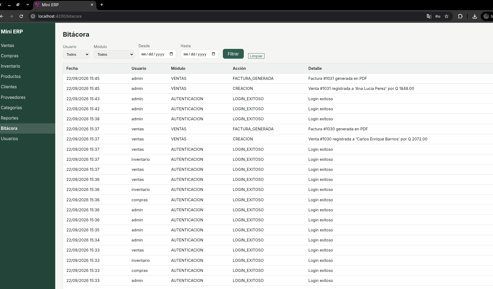

### Usuarios

Listado de los usuarios del sistema (usuario, nombre, rol, estado).
**Nuevo usuario** pide usuario, contraseña, nombre completo y rol.
**Editar** solo permite cambiar el nombre completo y el rol (no el usuario ni
la contraseña). **Desactivar** impide que ese usuario vuelva a iniciar
sesión, pero conserva su historial de acciones.

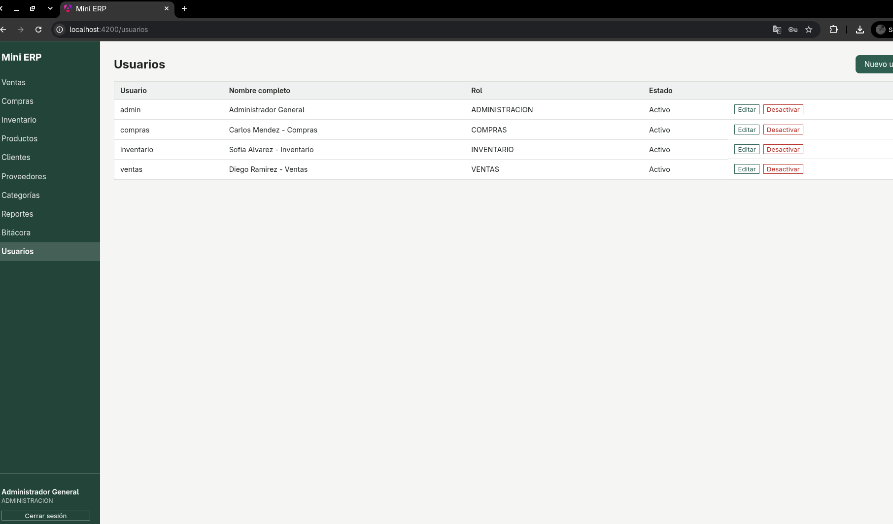

---

## Reportes (sección común)

La pantalla de Reportes muestra, como chips en la parte superior, solo los
reportes que tu rol tiene permitido ver. Al seleccionar uno:

- Si tiene filtro de fechas (Compras o Ventas en un rango), aparecen los
  campos **Desde** / **Hasta** y el botón **Filtrar**.
- Si es el resumen de ventas por período, aparece un selector con **Día**,
  **Semana**, **Mes** o **Año**.
- El resto se calcula y muestra de inmediato.

